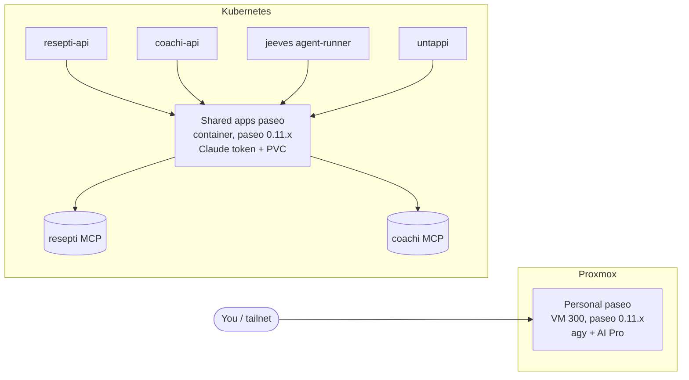

**Paseo** is the daemon that actually runs the AI coding agents. Everything in the
homelab that "uses AI" (jeeves, resepti import + cooking assistant, coachi coaching,
ad-hoc cluster debugging) drives a paseo daemon over the `paseo` CLI; paseo in turn
spawns the model CLI (**Claude Code**, or **Antigravity/`agy`** on 0.11.x+) in a
workspace with that app's MCP tools.

This page is the handover for **how paseo is deployed, how to upgrade it, and the
two-instance split we're moving to.**

## The two roles (why we split)

| | **1 — Personal** | **2 — Apps** |
|---|---|---|
| Purpose | interactive chat, cluster **debugging**, trying things | the always-on **app agents** (jeeves, resepti, coachi, untappi) |
| Who drives it | **you**, ad-hoc (tailnet) | the apps' backends, automatically |
| Auth | **AI Pro** via `agy` (your personal, unlimited) | **Claude** (work token) for tool agents; Gemini for tool-free |
| Lifecycle | you restart/break/experiment freely | stable, GitOps-managed, must not be disrupted by (1) |
| Blast radius | just you | all apps — keep it boring |

Keeping these separate means **your experiments can't take down production app
agents**, and the two can use **different credentials/quota** (your personal AI Pro
vs the shared work-Claude token).

## Current state (all on paseo 0.2.5 — too old for antigravity)

| instance | where | serves | auth |
|---|---|---|---|
| **`paseo-homelab`** (Proxmox VM 300, minipc) | VM, `systemd paseo.service`, tailnet `…:6767` | **personal / debug** | your login |
| `resepti-paseo-0` | k8s pod (resepti ns) | resepti | Claude token |
| `coachi-paseo-0` | k8s pod (coachi ns) | coachi | Claude token |
| `jeeves-paseo` | k8s container (jeeves) | jeeves | Claude token |

So today each app ships **its own** in-cluster paseo container, and the VM is a
separate personal one. The plan collapses the per-app containers into **one shared
apps paseo**, and keeps the VM as the personal one.

## Target architecture



Each app drives the **same** apps-paseo but in **its own workspace/project** (own
`cwd`, own `CLAUDE.md`/`GEMINI.md`, own MCP server). paseo supports many
projects/agents in one daemon, so one shared daemon is enough.

## Decision: is the apps paseo a VM or a container?

**Recommendation: a container (k8s), not a VM.** Reasoning:

- **It runs Claude, so it needs no keyring.** The app agents use **MCP tools**
  (resepti import, coachi coach-tools, jeeves), and **antigravity + MCP don't work
  together yet** — so those agents stay on **Claude**, which authenticates with a
  simple `CLAUDE_CODE_OAUTH_TOKEN` **env var**. Containers do env-var auth perfectly;
  the painful `agy` keyring problem (below) simply doesn't arise here.
- **It matches what already works** — resepti/coachi/jeeves paseo are *already*
  in-cluster containers. Consolidating them is a smaller step than moving to a VM.
- **GitOps-native** — declarative, versioned, auto-restart, resource limits, image
  bumps via PR. A VM is managed out-of-band (tofu/manual) and is heavier to operate.
- **Low latency to the MCP servers** (same cluster network).
- Persistent agent/workspace state lives on a **Longhorn PVC**.

Use a **VM only for the personal instance**, where you *do* want `agy`/AI-Pro
interactively (a real VM has a login session + keyring) and where you experiment.

| | apps = **container** (recommended) | apps = VM |
|---|---|---|
| Auth needed | Claude env token — trivial | same, but heavier host |
| agy/AI-Pro keyring | not needed (Claude) | moot (still Claude due to MCP) |
| Managed by | **GitOps** | tofu/manual |
| Restart/scale | k8s-native | manual |
| State | PVC | VM disk |

> **Revisit if** paseo gains antigravity-with-MCP support *and* you want app
> tool-agents on AI Pro — then the apps paseo would need a keyring and a VM (or
> solving keyring-in-container) becomes attractive. Until then: container.

## Auth & the Claude-vs-AI-Pro split

- **Tool-using agents → Claude** (via `CLAUDE_CODE_OAUTH_TOKEN`). Required because
  antigravity can't call MCP tools yet. This is the resepti **import**, coachi
  coach-tools, jeeves.
- **Tool-free agents → AI Pro / Gemini.** The resepti **assistant** (plain cooking
  Q&A) needs no tools, so it can run on your personal Gemini. It already does this
  *without paseo at all* via a direct Gemini REST call (resepti PR — `GEMINI_API_KEY`,
  gated). Simplest path; no keyring, no agy.
- **Personal/debug → AI Pro via `agy`** on the VM, interactively.

### The `agy` keyring problem (personal VM)

`agy` stores its OAuth creds in the Linux **Secret Service keyring**. A one-off
interactive login works on the VM, but the **systemd `paseo.service` has no keyring
session**, so a daemon-spawned `agy` can't read them. Options:

1. Run paseo as a **`systemd --user` service** + `loginctl enable-linger` + an
   **auto-unlocked** gnome-keyring (empty password) — the "proper" unattended fix.
2. Inject a headless keyring's dbus address into the unit environment (fiddlier).
3. **Avoid it:** use a **Gemini API key** (`modelProvider: gemini` + `GEMINI_API_KEY`)
   instead of OAuth — no keyring at all. Best for anything headless/automated.

## Upgrading paseo 0.2.5 → 0.11.2

0.11.2 is required for the `antigravity` provider (verified: `provider ls` lists
`antigravity (Enabled)` on 0.11.2). Two gotchas found the hard way:

- ⚠️ **Config breaking change:** 0.11.2 **rejects `daemon.hostnames`** — our 0.2.5
  `~/.paseo/config.json` has `"hostnames": true`; remove it or the daemon won't boot.
- ⚠️ **Never restart the VM's paseo from a shell that runs *through* it.** On VM 300
  the Claude/SSH session is a child of the paseo daemon (`bash → … → paseo daemon`),
  so `systemctl restart paseo` kills your own session. **SSH in directly** (not via
  paseo's web terminal) to upgrade.

### Personal VM (300)
```sh
ssh root@192.168.1.11 'qm snapshot 300 preupgrade011'   # snapshot FIRST (from the Proxmox host)
ssh arseni@paseo-homelab                                 # DIRECT ssh, not paseo's terminal
sudo npm i -g @getpaseo/cli@latest                       # 0.2.5 -> 0.11.2
sudo sed -i '/"hostnames"/d' ~/.paseo/config.json        # drop the invalid field
paseo --version                                          # expect 0.11.2
sudo systemctl restart paseo
paseo provider ls                                        # expect antigravity = Enabled
```
Rollback if needed: `ssh root@192.168.1.11 'qm rollback 300 preupgrade011'`.

### Apps paseo (container)
Bump the image tag / `@getpaseo/cli` version in its Dockerfile, build, push, and
update the tag in `cluster/apps/<app>/…` (ArgoCD rolls it out). Pods are ephemeral,
so there's no session-kill risk; just verify `paseo provider ls` in the new pod and
re-check each app's smoke test.

## Migration plan (consolidate per-app → shared apps paseo)

1. **Validate 0.11.2 + antigravity + agy on the personal VM first** (low risk, it's
   yours). ← the one `agy` login is the gating step.
2. Build a **shared apps-paseo container** on 0.11.2 with a PVC, Claude token, and a
   workspace/project per app (each app's `cwd` + MCP).
3. Repoint apps one at a time via `PASEO_HOST` (resepti/coachi already support
   `PASEO_HOST/PORT/SSL/PASSWORD`): **resepti → coachi → untappi** (jeeves last, or
   keep its own — it's the heaviest/most isolated).
4. Decommission `resepti-paseo-0` + `coachi-paseo-0` pods (also frees worker-node CPU).
5. Keep **Claude for tool agents**; move tool-free ones (resepti assistant) to Gemini.

## Keep-the-separation checklist
- **Different credentials:** personal = your AI-Pro `agy` login; apps = the shared
  `CLAUDE_CODE_OAUTH_TOKEN` (1Password → ESO). Don't cross them.
- **Different endpoints:** personal on the **tailnet** only (`…:6767`, password-auth);
  apps paseo on the **cluster network**, reached by `PASEO_HOST` service DNS.
- **Lifecycle isolation:** restart/experiment on the VM freely; treat the apps paseo
  as production (change via PR + smoke test).
- **One upgrade at a time:** validate on personal, then roll apps.

## See also
- [Jeeves](/jeeves/) — the autonomous maintenance agent (its own paseo).
- VM-local runbook (more terse): `/home/arseni/PASEO-AI-PRO-UPGRADE.md` on VM 300.
