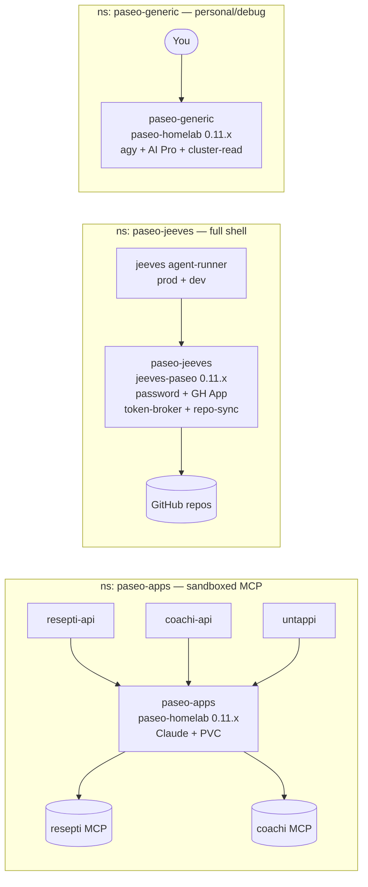

**Paseo** is the daemon that actually runs the AI coding agents. Everything in the
homelab that "uses AI" (jeeves, resepti import + cooking assistant, coachi coaching,
ad-hoc cluster debugging) drives a paseo daemon over the `paseo` CLI; paseo in turn
spawns the model CLI (**Claude Code**, or **Antigravity/`agy`** on 0.11.x+) in a
workspace with that app's MCP tools.

This page is the handover for **how paseo is deployed, how to upgrade it, and the
three-tier split we run** (and the rule for which tier a new agent belongs to).

## The three tiers (the model)

A paseo daemon's tier is decided by the **agent's capability + trust profile — not by
which app it is**. That single rule is what keeps the fleet consolidated instead of
sprawling into one bespoke daemon per app:

| | **`paseo-apps`** | **`paseo-jeeves`** | **`paseo-generic`** |
|---|---|---|---|
| Agent shape | **sandboxed tool agents** — MCP tools + WebFetch, no shell | **full-shell engineering agent** — edits code, runs builds/tests, git commit/push | **interactive personal/debug** — full shell, cluster-read |
| Who/what | resepti, coachi, untappi (+ any future MCP app) | Jeeves (prod + dev agent-runners) | **you**, ad-hoc |
| Shared? | **yes** — one boring daemon for all of them | one daemon, both Jeeves instances as labelled agents | just you |
| Auth | Claude work token; host-allowlist, no password | Claude token **+ `PASEO_PASSWORD`** + GitHub App | your **AI Pro** via `agy` |
| Image | portable `paseo-homelab` | `jeeves-paseo` (adds the jeeves git-cred helper + sidecars) | portable `paseo-homelab` |
| Blast radius | all apps — **keep it boring** | repos it can push to | just you |

**Will the MCP apps ever need their own daemons?** No — not unless one stops being a
*tool* agent and becomes an *engineering* agent. resepti/coachi/untappi reason over app
data by calling MCP tools; they never touch a filesystem, shell, or git, so the
sandboxed shared `paseo-apps` daemon is their stable, permanent home. Only an agent that
needs a **shell + git + repos** earns the `paseo-jeeves` tier (today: just Jeeves; Flock
self-develops *via* Jeeves, so it needs nothing of its own). Anything you drive by hand
is `paseo-generic`. New agent → **share `paseo-apps` by default**; promote to
`paseo-jeeves` only if it needs a shell.

Keeping the tiers separate means **your experiments and Jeeves's full-shell agents can't
take down the boring app agents**, and each tier uses the **right credentials/quota**
(your personal AI Pro vs the shared work-Claude token vs Jeeves's App identity).

## Current state (all on paseo 0.2.5 — too old for antigravity)

| instance | where | serves | auth |
|---|---|---|---|
| **`paseo-homelab`** (Proxmox VM 300, minipc) | VM, `systemd paseo.service`, tailnet `…:6767` | **personal / debug** | your login |
| `resepti-paseo-0` | k8s pod (resepti ns) | resepti | Claude token |
| `coachi-paseo-0` | k8s pod (coachi ns) | coachi | Claude token |
| `jeeves-paseo` | k8s StatefulSet (jeeves ns) | jeeves **prod** | Claude token + password + GH App |
| `jeeves-dev` | k8s StatefulSet (jeeves-dev ns) | jeeves **dev** | Claude token + password + GH App |

So today each app ships **its own** in-cluster paseo container (jeeves runs *two* — a
prod `jeeves-paseo` and a dev `jeeves-dev`). The migration collapses these into the
**three tiers** above: resepti/coachi/untappi fold into **one shared `paseo-apps`
daemon**; both Jeeves instances move onto the **`paseo-jeeves`** daemon (its own tier +
namespace — the full-shell exception); and `paseo-generic` is the personal/debug tier.

## Target architecture



resepti/coachi/untappi drive the **same** shared `paseo-apps` daemon, each in **its own
workspace/project** (own `cwd`, own `CLAUDE.md`/`GEMINI.md`, own MCP server) — paseo runs
many projects/agents in one daemon, so one shared daemon is enough for the sandboxed,
MCP-only app agents. **Jeeves is the exception** and gets its own tier/namespace,
`paseo-jeeves` (next section). **You** get `paseo-generic` for interactive debugging.

## `paseo-jeeves` — the full-shell tier

Jeeves runs on its **own daemon in its own namespace** (`paseo-jeeves`), not as a tenant
of the sandboxed shared `paseo-apps` pod. Its agents are the opposite of the
resepti/coachi "boring, safe" model, so the tier adopts the portable-image + GitOps
pattern but with its own workspace, sidecars, and auth:

| | shared apps paseo (resepti/coachi/untappi) | Jeeves |
|---|---|---|
| Agent model | **sandboxed, MCP-only** (`settings.json` denies `Bash`/`Edit`/`Write`) | **full shell** — bash, git, edit, commit, push |
| Workspace | static ConfigMap (`/workspaces/<app>/` + `.mcp.json`) | repo-centric git **worktrees** off a repo-sync'd PVC |
| Daemon auth | none — Host-header allowlist (`PASEO_HOSTNAMES`), *not* a password | **`PASEO_PASSWORD`** (a jeeves invariant: always inject `--host`+password) |
| Sidecars | none | **token-broker** (mints short-lived GitHub App tokens over a unix socket — the App PEM never enters the agent container) + **repo-sync** (base clones) |
| Extra secrets | Claude token only | + GitHub App PEM, `jeeves-repos` configMap, read-only infra creds (kubeconfig/talos/opnsense) |

A literal single-pod merge would force the shared daemon to allow a full shell and to
hold the GitHub App PEM — defeating the "keep it boring" isolation the whole split
exists for. So Jeeves gets the **`paseo-jeeves`** tier: its own namespace + daemon,
sharing only the GitOps pattern and the 0.11.x base. Both the prod (`jeeves-paseo`) and
dev (`jeeves-dev`) agent-runners point at it.

> **Auth — resolved:** 0.11.x enforces a daemon **password AND** a host-allowlist
> *together* (they're independent), so Jeeves keeps its password model unchanged — the
> `jeeves-paseo` image's entrypoint writes `daemon.auth.password` + a `hostnames` array
> and the client's `--host …?password=` form is version-stable. Validated end-to-end
> against a live 0.11.2 daemon (boot, auth, run/poll/send/ls/archive, idempotent worktree
> create); the only non-blocking gap is `worktree archive` (best-effort, covered by
> create-idempotency). See jeeves#170.

## Decision: is the apps paseo a VM or a container?

**Recommendation: a container (k8s), not a VM.** Reasoning:

- **It runs Claude, so it needs no keyring.** The app agents use **MCP tools**
  (resepti import, coachi coach-tools, jeeves), and **antigravity + MCP don't work
  together yet** — so those agents stay on **Claude**, which authenticates with a
  simple `CLAUDE_CODE_OAUTH_TOKEN` **env var**. Containers do env-var auth perfectly;
  the painful `agy` keyring problem (below) simply doesn't arise here.
- **It matches what already works** — resepti/coachi/jeeves paseo are *already*
  in-cluster containers. Consolidating them is a smaller step than moving to a VM.
- **GitOps-native** — declarative, versioned, auto-restart, resource limits, image
  bumps via PR. A VM is managed out-of-band (tofu/manual) and is heavier to operate.
- **Low latency to the MCP servers** (same cluster network).
- Persistent agent/workspace state lives on a **Longhorn PVC**.

Use a **VM only for the personal instance**, where you *do* want `agy`/AI-Pro
interactively (a real VM has a login session + keyring) and where you experiment.

| | apps = **container** (recommended) | apps = VM |
|---|---|---|
| Auth needed | Claude env token — trivial | same, but heavier host |
| agy/AI-Pro keyring | not needed (Claude) | moot (still Claude due to MCP) |
| Managed by | **GitOps** | tofu/manual |
| Restart/scale | k8s-native | manual |
| State | PVC | VM disk |

> **Revisit if** paseo gains antigravity-with-MCP support *and* you want app
> tool-agents on AI Pro — then the apps paseo would need a keyring and a VM (or
> solving keyring-in-container) becomes attractive. Until then: container.

## Auth & the Claude-vs-AI-Pro split

- **Tool-using agents → Claude** (via `CLAUDE_CODE_OAUTH_TOKEN`). Required because
  antigravity can't call MCP tools yet. This is the resepti **import**, coachi
  coach-tools, jeeves.
- **Tool-free agents → AI Pro / Gemini.** The resepti **assistant** (plain cooking
  Q&A) needs no tools, so it can run on your personal Gemini. It already does this
  *without paseo at all* via a direct Gemini REST call (resepti PR — `GEMINI_API_KEY`,
  gated). Simplest path; no keyring, no agy.
- **Personal/debug → AI Pro via `agy`** on the VM, interactively.

### The `agy` keyring problem (personal VM)

`agy` stores its OAuth creds in the Linux **Secret Service keyring**. A one-off
interactive login works on the VM, but the **systemd `paseo.service` has no keyring
session**, so a daemon-spawned `agy` can't read them. Options:

1. Run paseo as a **`systemd --user` service** + `loginctl enable-linger` + an
   **auto-unlocked** gnome-keyring (empty password) — the "proper" unattended fix.
2. Inject a headless keyring's dbus address into the unit environment (fiddlier).
3. **Avoid it:** use a **Gemini API key** (`modelProvider: gemini` + `GEMINI_API_KEY`)
   instead of OAuth — no keyring at all. Best for anything headless/automated.

## Upgrading paseo 0.2.5 → 0.11.2

0.11.2 is required for the `antigravity` provider (verified: `provider ls` lists
`antigravity (Enabled)` on 0.11.2). Two gotchas found the hard way:

- ⚠️ **Config breaking change:** 0.11.2 **rejects `daemon.hostnames`** — our 0.2.5
  `~/.paseo/config.json` has `"hostnames": true`; remove it or the daemon won't boot.
- ⚠️ **Never restart the VM's paseo from a shell that runs *through* it.** On VM 300
  the Claude/SSH session is a child of the paseo daemon (`bash → … → paseo daemon`),
  so `systemctl restart paseo` kills your own session. **SSH in directly** (not via
  paseo's web terminal) to upgrade.

### Personal VM (300)
```sh
ssh root@192.168.1.11 'qm snapshot 300 preupgrade011'   # snapshot FIRST (from the Proxmox host)
ssh arseni@paseo-homelab                                 # DIRECT ssh, not paseo's terminal
sudo npm i -g @getpaseo/cli@latest                       # 0.2.5 -> 0.11.2
sudo sed -i '/"hostnames"/d' ~/.paseo/config.json        # drop the invalid field
paseo --version                                          # expect 0.11.2
sudo systemctl restart paseo
paseo provider ls                                        # expect antigravity = Enabled
```
Rollback if needed: `ssh root@192.168.1.11 'qm rollback 300 preupgrade011'`.

### Apps paseo (container)
Bump the image tag / `@getpaseo/cli` version in its Dockerfile, build, push, and
update the tag in `cluster/apps/<app>/…` (ArgoCD rolls it out). Pods are ephemeral,
so there's no session-kill risk; just verify `paseo provider ls` in the new pod and
re-check each app's smoke test.

## Migration plan (consolidate per-app → shared apps paseo)

1. **Validate 0.11.2 + antigravity + agy on the personal VM first** (low risk, it's
   yours). ← the one `agy` login is the gating step.
2. Build a **shared apps-paseo container** on 0.11.2 with a PVC, Claude token, and a
   workspace/project per app (each app's `cwd` + MCP).
3. Repoint the MCP apps one at a time via `PASEO_HOST` (resepti/coachi already support
   `PASEO_HOST/PORT/SSL/PASSWORD`): **resepti → coachi → untappi** into the shared
   daemon.
4. **Stand up the `paseo-jeeves` tier** (its own namespace + daemon — *not* the shared
   pod; see `cluster/apps/paseo-jeeves/`). The client/daemon 0.11.x work is done and
   validated (jeeves#170); the `paseo-jeeves` StatefulSet + secrets are in GitOps. Then
   repoint **dev** (`jeeves-dev`'s `PASEO_HOST` → `paseo-jeeves.paseo-jeeves.svc`) and
   soak on the Flock card loop, then **prod** (`jeeves-paseo`).
5. Decommission the old per-app daemons — `resepti-paseo-0`, `coachi-paseo-0`, and the
   embedded `jeeves-paseo`/`jeeves-dev` StatefulSets in the jeeves namespaces — once each
   is cut over and soaked (also frees worker-node CPU).
6. Keep **Claude for tool agents**; move tool-free ones (resepti assistant) to Gemini.

## Keep-the-separation checklist
- **Different credentials:** personal = your AI-Pro `agy` login; apps = the shared
  `CLAUDE_CODE_OAUTH_TOKEN` (1Password → ESO). Don't cross them.
- **Different endpoints:** personal on the **tailnet** only (`…:6767`, password-auth);
  apps paseo on the **cluster network**, reached by `PASEO_HOST` service DNS.
- **Lifecycle isolation:** restart/experiment on the VM freely; treat the apps paseo
  as production (change via PR + smoke test).
- **One upgrade at a time:** validate on personal, then roll apps.

## See also
- [Jeeves](/jeeves/) — the autonomous maintenance agent (its own paseo).
- VM-local runbook (more terse): `/home/arseni/PASEO-AI-PRO-UPGRADE.md` on VM 300.
